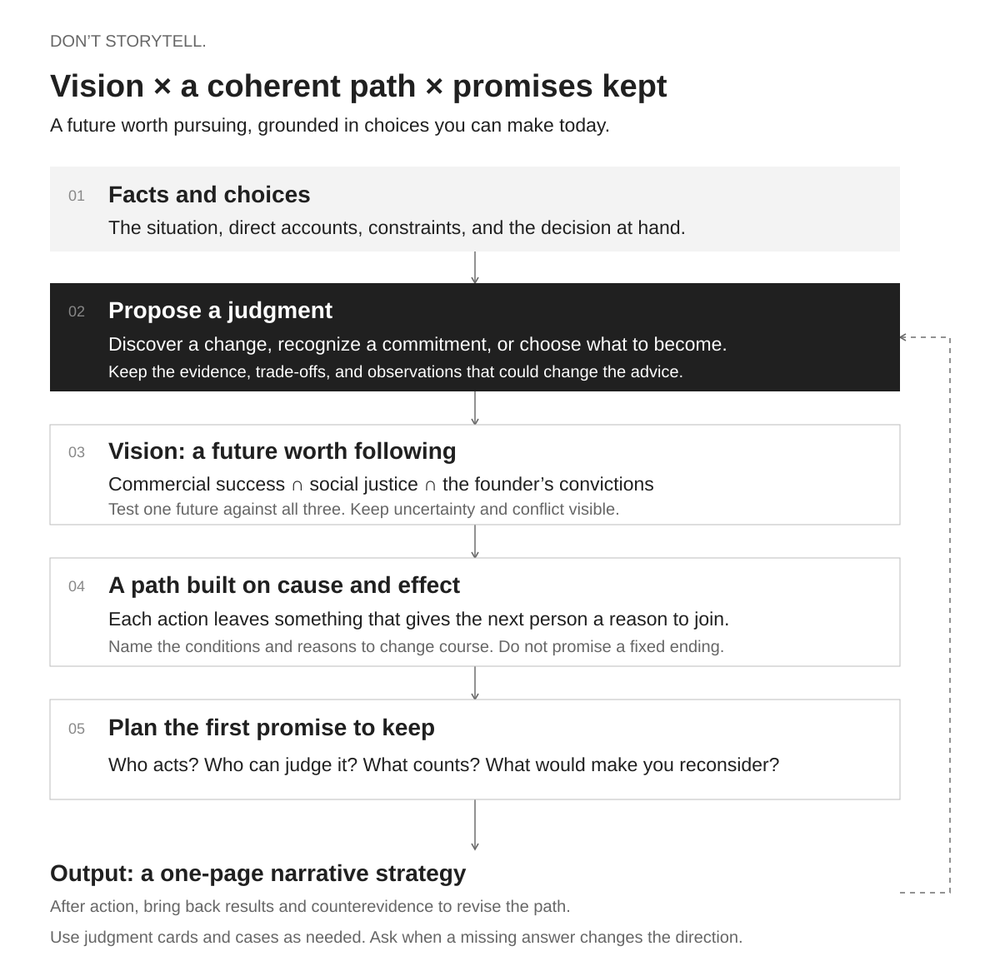

# Don’t Storytell.

**Don’t tell a story. Become one.**

**English** · [简体中文](README.zh-CN.md)

A narrative engineering skill for founders, product leaders, creators, and small businesses. Bring your materials. Get a one-page strategy: what has actually happened, which direction is worth pursuing, what that choice rules out, and how each step gives someone a reason to join the next.

[Install](#install) · [Try it](#your-first-session) · [Read the Skill instructions (Chinese)](SKILL.md) · [Read a complete example](examples/neighborhood-magazine.en.md)

## What “narrative” means here

A story begins with a compelling vision, at the intersection of **commercial success, social justice, and the founder’s convictions**. Narrative is the process of making that vision real, with people watching, taking part, and deciding whether to trust the next promise.

All three must meet in the same future. Commercial success asks who will pay and what keeps the business alive. Social justice can be as modest as giving someone a choice they previously lacked. The founder’s convictions come from lived experience, standards they keep, and opportunities they are willing to decline.

**A strong narrative = a compelling vision × a coherent path × promises kept.**

The path contains real choices. Taking one makes certain next steps possible. Keeping a promise gives others something to judge: a product they can use, a reason to join the team, a better basis for a partnership. Trust, reputation, talent, and bargaining power may grow from that record.

This is a method for making business and creative decisions. It is not a shortcut to a polished pitch, a launch performance, or a slogan. If the materials cannot support a claim, the skill identifies the gap and proposes a concrete first move. A story can start with a small shop or an individual; it does not need a grand mission or a dramatic past.

## How it works



| Step | What it produces |
| --- | --- |
| Understand the brief | The whole business or undertaking, the decision at hand, and what the person can actually change |
| Establish facts and choices | A grounded account of the situation and a choice that affects what follows |
| Propose a judgment | Supported alternatives, a recommendation, its trade-offs, and observations that would distinguish the alternatives |
| Form a vision | One future in which commercial success, social justice, and the founder’s convictions meet |
| Build the path | Each step leaves capabilities, work, or relationships that give the next participant a reason to commit |
| Plan the first promise | Who acts, who can judge the result, what counts as delivery, and when to change course |

A judgment can come from a discovery, a long-held commitment, or something a beginner wants to create. A trade-off can be as simple as which project gets your time first. You do not need to manufacture a sacrifice. The skill can recommend a direction without pretending you have already chosen it.

For example, imagine a neighborhood magazine. A shopping center offers to cover a year’s paper costs in exchange for control of every cover. Neighbors suggest people to feature, but nobody has subscribed. The skill distinguishes two plausible businesses: a publication for the sponsor, or a magazine readers support. Choosing the latter changes editorial control, presales, and the reason a reader would come back for the next issue.

The [complete fictional example](examples/neighborhood-magazine.en.md) includes the input, reasoning, and the one-page strategy. It is an illustration of the method, not a reported client outcome.

## Install

For the current English guide and examples, clone this repository into your personal skills directory:

```bash
mkdir -p ~/.codex/skills
git clone https://github.com/noi-liuchang/dont-storytell.git ~/.codex/skills/noi-narrative-engineering
```

If that directory already exists, preserve your local changes before updating. Start a new conversation and invoke `$noi-narrative-engineering`. The repository is named `dont-storytell`; the installation directory and invocation name are `noi-narrative-engineering`.

You can also download the [v1.2-beta.1 Skill ZIP](https://github.com/noi-liuchang/dont-storytell/releases/download/v1.2-beta.1/noi-narrative-engineering-v1.2-beta.1.zip) and place the extracted `noi-narrative-engineering` folder in `~/.codex/skills/`. That archive predates the English documentation update.

**Language coverage:** this guide, the diagram, and the worked example are in English. The operating instructions, reference library, and HTML rendering templates remain primarily in Chinese. Ask the assistant to respond in your preferred language.

## Your first session

Provide a pitch deck, product documentation, interviews, business development notes, sales records, or your own work. Local file paths are fine. You can also name a company and explicitly ask the assistant to use public sources.

```text
$noi-narrative-engineering
Read these materials and give me a one-page narrative strategy in English.
The decision we are struggling with is ______.
```

The last sentence is optional. With enough evidence, the skill drafts a strategy. With incomplete evidence, it produces a conditional version. When a missing answer would change the direction and only you can provide it, it offers its current reading and asks a focused question. It does not require a fixed interview before every draft.

For a guided conversation, try: “I want to build a media product about AI and culture. Help me work through it.” To revisit a strategy, bring the new fact: “The partner will fund it, but only with exclusivity.” The skill should reconsider which next steps still hold.

**The output is a page you can use to make decisions.** It opens with the project’s own situation, sets out a recommended future and a connected sequence of actions, then names the first step and the signals for changing course. It usually reads as a short memo, with a compact table when comparison helps. There is no mandatory three-act structure. Facts, interpretations, and proposed actions stay distinct.

## Where the method comes from

According to noi’s handbook, the method draws on one-to-one consultations with 99 AI founders, co-founders, and executives, totaling more than 200 hours, alongside roughly 50,000 Chinese characters of related writing. These figures describe the author’s experience; they do not mean the repository contains the private source material.

The distillation organized relevant ideas from 44 groups of articles, drafts, and mind maps into 78 judgment cards, then incorporated further material. Groups include versions of the same topic. Written judgments were checked against recordings attributed to the author; past proposals remain proposals, not evidence that they succeeded.

The case library contains 112 sourced cards: 70 positive, 27 negative, and 15 with mixed outcomes. Historical paths help connect successive decisions; individual cases test a specific move’s conditions and costs. Cases are read as needed. There is no requirement to read the whole library or force a positive/negative pair into every answer. Someone else’s success is not proof that your plan will work.

| Explore | Reference |
| --- | --- |
| Convictions, credibility, taste, and promises kept | [Author’s principles](references/author-thesis.md) (Chinese) |
| Situation → judgment → changed advice → limits | [78 judgment cards](references/author-decisions.md) (Chinese) |
| Finding the consequential event in the material | [Consultation craft](references/consultation-craft.md) (Chinese) |
| Learning from real sequences of decisions | [Historical paths](references/story-paths.md) (Chinese) · [Case library](references/casebook.json) (primarily Chinese) |
| The one-page format and offline renderer | [Output guide](references/deliverable.md) (Chinese) |

For local tools, use Python 3 from the repository root:

```bash
python3 scripts/find_cases.py --id E074 E075
python3 scripts/render_strategy.py examples/neighborhood-magazine.json strategy.html
```

The commands above use the existing Chinese case records and example. The English worked example is available as [Markdown](examples/neighborhood-magazine.en.md).

## Status and limits

The method is at **v1.2-beta.1**. Its sequence is judgment, vision, a causal path, and the first promise to keep. The 78 judgment cards include limits; case retrieval is selective.

Private consultation transcripts, pitch decks, recordings, and local evaluation material are excluded. Small comparative trials can reveal problems; they do not establish that the author has endorsed every output, that the skill works for every business, or that a strategy will succeed. New evidence should be able to change the plan.
