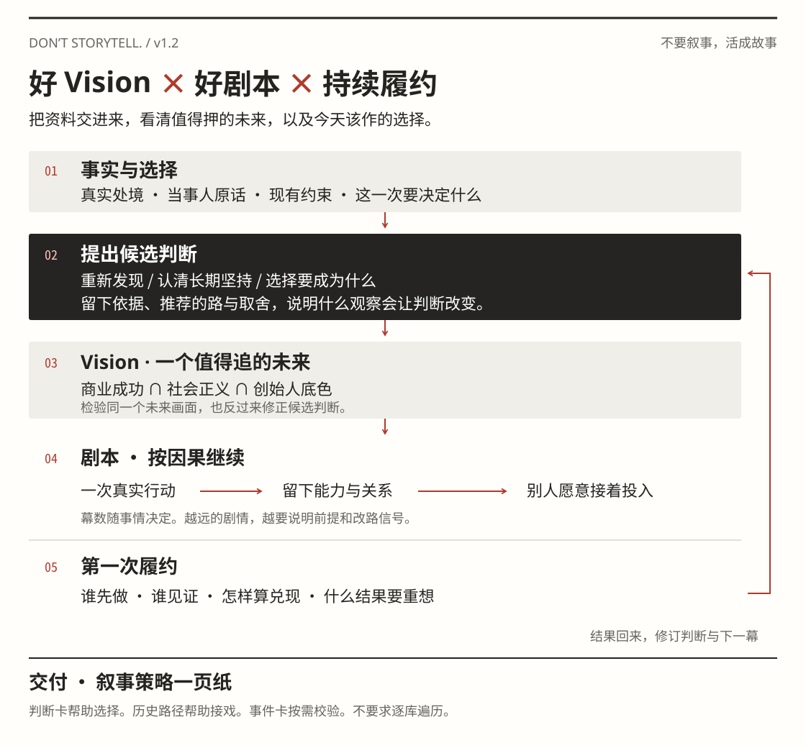

# Don’t Storytell.

[English](README.md) · **简体中文**

**不要叙事，活成故事。**

给创始人、产品负责人、创作者和小生意的一份叙事咨询 Skill。把手上的材料交进来，它会给你一页纸：这门生意里已经发生了什么，哪条路值得押，选了它会暂不做什么，下一件事留下什么，谁会有理由继续跟你走。

[安装](#安装) · [直接试一次](#第一次使用) · [看一份完整的一页纸](examples/neighborhood-magazine.md) · [读 Skill 原文](SKILL.md)

## 这里说的“叙事”是什么？

故事源于一个有吸引力的 Vision。它是**商业成功、社会正义、创始人底色**的交集。一家商业体，在观众的关注下，逐步实现这个 Vision 的过程，就是叙事。

三个词要落在同一件事上。商业成功，问的是谁愿意付钱，怎样让这门生意活下去。社会正义，可以小到一个原本没有选择的人，现在手里多了一项权利。创始人底色，要回到他亲历过什么，愿意坚持什么，遇到好条件时又肯放弃什么。

**好叙事 = 好 Vision × 好剧本 × 持续履约。** 好剧本里有真正的岔路，选了其中一条，后面的事才会发生。履约则要有人亲眼见过，甚至愿意为它付钱、加入团队、重新谈合作，或者把下一次机会交给你。信任、口碑、人才和议价权，可能就这样一点点长出来。

这也是它和写 BP、打磨发布会、起一句品牌口号的区别。你得先决定怎么做，才知道有什么值得讲。如果材料里还看不到产品为谁解决问题，这一页会直接指出缺口，给一件先做的小事。

## 它怎样从材料走到一页纸



| 过程 | 这一步留下什么 |
| --- | --- |
| 接住命题 | 理解整门生意、当事人想解决什么，不按资料多少或公司大小决定问几题 |
| 事实与选择 | 一段真实处境，以及一次会改变后续的选择 |
| 提出判断 | 有依据的候选，推荐押哪条、暂不选哪条，什么观察能区分它们 |
| Vision | 商业成功、社会正义、创始人底色在同一个未来画面里相遇 |
| 剧本 | 上一步留下的东西，让下一个人愿意投入，后续按这个因果继续 |
| 履约与成稿 | 第一步、见证者、兑现条件，以及出现什么结果就改路 |

判断可以来自一次新发现，也可以来自多年坚持，或者刚起步时想做的第一件事。取舍可以是把时间先给哪件作品，不要求你先受损或放弃一大笔钱。候选仍能有鲜明建议，只是不能替你宣布一个尚未认领的身份。

假设你办了一本街区杂志。商场愿意预付全年纸张费，却要求决定每期封面。街坊愿意推荐人，还没有人订阅。你希望它成为街区自己的刊物。Skill 会辨认两门都说得通的生意，分别是为商场办刊，以及办一本读者愿意买的杂志。若押后一条，就要解决编辑选题权、首期预售、读者为何回来，以及他们为什么愿意带来下一个值得写的人。

这是一份虚构示范。文件里有原始输入、关键判断及其依据，还有实际交付的一页纸。[完整示范](examples/neighborhood-magazine.md)

## 安装

**用 Codex 安装包。** 下载 [v1.2-beta.1 的 Skill ZIP](https://github.com/noi-liuchang/dont-storytell/releases/download/v1.2-beta.1/noi-narrative-engineering-v1.2-beta.1.zip)，解压后将整个 `noi-narrative-engineering` 文件夹放到个人技能目录 `~/.codex/skills/`。开启新对话，即可用 `$noi-narrative-engineering` 调用。已有同名安装时，先保留自己的修改。

也可以在首次安装时用 Git 克隆。仓库名是 `dont-storytell`，安装目录与调用名都是 `noi-narrative-engineering`。

```bash
mkdir -p ~/.codex/skills
git clone https://github.com/noi-liuchang/dont-storytell.git ~/.codex/skills/noi-narrative-engineering
```

仓库为私有时，下载和克隆需要有访问权限的 GitHub 账号。已登录 GitHub CLI 的用户也可用 `gh repo clone noi-liuchang/dont-storytell ~/.codex/skills/noi-narrative-engineering`。

## 第一次使用

把 BP、产品手册、客户或创始人访谈、BD 记录、作品、销售数据放进当前对话。本地文件也可以给路径。能明确对象时，只给公司名并指定使用公开资料也可以开始。

```text
$noi-narrative-engineering
读这些材料，给我一页叙事策略。我们眼下最难决定的是 ______。
```

最后一句可省。材料够用就直接交稿，依据不全则交候选页。只有一个必须由你回答的问题会改变主线时，才先给判断、再追问。如果你只有一个念头，可以说“我想做一个聊 AI 和文化的媒体产品，带我往下走”。如果你已经有一页策略，把新的事实一起交来，例如“合作方肯出钱，但要求独家”，它会重新判断哪一幕还能成立。

**你会拿到一页可以作决定的策略。** 用项目自己的一个问题或场面起笔，说清当事人面临的选择、推荐的未来、相连的剧情、第一步和改路信号。默认连贯短稿，需要比较动作时可用紧凑表格，不固定三幕。发生过的事、顾问的推断、还需要当事人兑现的设想都分得开。你可以在聊天里读，也可以要求输出可离线打开、适合打印的一页纸。

## 这些判断从哪里来？

按 noi 的使用手册，这套方法来自与 99 位 AI 创始人、联合创始人和 CXO 的一对一咨询，累计超过 200 小时，以及约 5 万字的相关写作。这个数字描述咨询与写作经历。仓库收的是从材料中提炼出来的判断、可核查的公开案例和虚构示例。

整理时，将 44 组文章、草稿和脑图中的相关观点归成 78 项判断，之后又补收其他材料。这里的“组”含同题版本。书面判断与带本人标签的录音互相对照，历史提案仍按提案看待。

另有 112 张有公开来源的案例卡，包括 70 个正例、27 个反例和 15 个得失并存的案例。历史路径帮助理解前后怎样接起来，事件卡帮助检验一个具体决定的前提和代价。按问题读取，无需每轮翻完或凑正反配额。乔布斯、马斯克、社区书店各有各的路径，不能拿别人的成功替自己背书。

| 想看什么 | 从哪里读 |
| --- | --- |
| noi 怎样理解立场、资格、Taste 和履约 | [作者判断法](references/author-thesis.md) |
| 处境、判断、建议变化、不适用条件怎样对应 | [78 项咨询判断](references/author-decisions.md) |
| 怎样从一份材料里选出真正有戏的事 | [咨询稿的写法](references/consultation-craft.md) |
| 怎样从真实案例找到下一步 | [Storyteller 的成长路径](references/story-paths.md) · [112 张案例卡](references/casebook.json) |
| 怎样生成或打印自己的策略页 | [一页纸格式](references/deliverable.md) |

常规咨询直接调用 Skill 即可。想在本地检索案例或生成示例 HTML，可在仓库根目录用 Python 3 运行：

```bash
python3 scripts/find_cases.py --tag 治理 --sign 反例 --limit 3
python3 scripts/render_strategy.py examples/neighborhood-magazine.json strategy.html
```

## 这次版本的边界

当前为 v1.2-beta.1。入口改为先提出判断，再形成 Vision、因果剧情与履约，78 项判断补上适用边界，案例改为按需读取。私人原始咨询材料不进入仓库。行为试跑与作者最终认可分开，少量案例能帮助发现问题，不能证明这套方法适用于所有商业命题。你带来新的事实后，策略应当允许改路。
